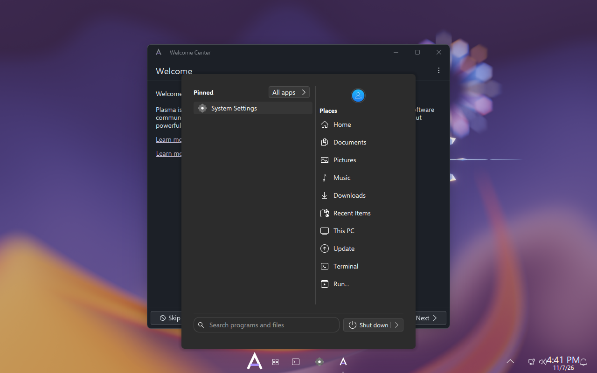

# Ankh DE

**Windows 11 geometry. Ankh colours. On KDE Plasma 6.**

*[Version française](README.md) — the project's primary language is French; this file is
maintained in English because the people who would install this don't all read French.*

Ankh DE gives Plasma the metrics, typography, materials, motion and shell layout of Windows 11 —
to the pixel **where the bench measures it** — in the graphite-and-violet identity of
[Ankh](https://github.com/PatrickChoumi/Ankh). It modifies no file belonging to your
distribution, and it uninstalls in one command.

**It is not a desktop written from scratch, and that is deliberate.** Ankh DE *dresses* KDE
Plasma: exactly one piece of the panel is ours, the Start menu. Everything else — tasks, system
tray, clock and calendar, notifications, Alt+Tab — are Plasma's **native** applets, wearing our
style. The component-by-component audit that led there is in
[docs/SIMPLIFICATION.md](docs/SIMPLIFICATION.md) (French, [DE-015](DECISIONS.md)).

> ### Status: pre-release, stated without rounding
>
> | Where | What is established |
> |---|---|
> | **Fedora 44, Plasma 6.8.2** | the session opens from the login screen, installed by `installer.sh` in a fresh VM. `ANKH_DE_SESSION=1`, style `Ankh`, colours `Ankh`, font `Selawik 10.5`, decoration `org.ankh.decoration`, icons `Fluent-Ankh`, Plasma style `ankh`. **48 key-by-key checks** passing *inside the session* |
> | **Ubuntu 26.04, Plasma 6.6** — **the target** | **the session opens** from the login screen and **every setting applies** — style `Ankh`, `Selawik 10.5`, `org.ankh.decoration`, `Fluent-Ankh`, Plasma style `ankh` — run `42397366933`. That run nonetheless ended in failure, on a harness defect unrelated to Ankh DE; the key-by-key checks did not run. Detail: [docs/ANTI_DOUBLONS.md](docs/ANTI_DOUBLONS.md) |
> | **Arch** | the code builds. No install, no session |
>
> **The functional state of each piece — installed, loaded, interactive, validated — lives in
> [docs/ANTI_DOUBLONS.md](docs/ANTI_DOUBLONS.md) and nowhere else.** This README does not restate
> it: on 2026-11-07 five documents carried five different versions of it, and
> `ci/verifier-coherence.sh` now refuses that.
>
> **The Start menu takes the keyboard**, and that is the only interaction proven so far. Since
> 2026-11-07 the harness **clicks and types** in the VM through QEMU's input events (proof SHA:
> `09e4950`).
>
> | Question | What the run answers |
> |---|---|
> | Which layout did `plasmashell` evaluate? | `…/org.ankh.de.desktop/…/org.kde.plasma.desktop-layout.js` — **ours**, from its own log |
> | Did the screen change on open? | **11.40 %** of it, a 675×707 box at x=302 of 1280 — **centred**, not pinned left like Kickoff |
> | Does the menu take the keyboard **without a click inside it**? | **yes** — type `konsole`, results appear. That is the Windows 11 gesture: press Windows, then type |
> | Does Escape close it? | **yes**, 11.69 % of the screen comes back |
> | Does clicking the right-hand area open a panel? | **yes** — 18.12 % and 16.25 %. But the locator yields an abscissa, not an identifier: **we do not know which applet answered** |
>
> **What is NOT proven**, and would be easy to let you assume: that Start **launches** an
> application (the test exists since 2026-11-07 and has not reported yet); that Alt+Tab shows
> anything (the three runs that tried had no second window); that the network, Bluetooth, volume
> and brightness tiles respond; that the calendar opens; that lock and logout work; that the
> uninstaller returns a real machine to stock Plasma.
>
> **27 of 53 tokens measured and conforming** — 12 controls, 6 windows, and **all 9 for the
> panel**, measured in a VM on `fbe7f47`. Detail and limits: [AVANCEMENT.md](AVANCEMENT.md)
> (French).



## What it is

| | |
|---|---|
| **Widget style** | A Qt 6 `QStyle` derived from Breeze: 4 and 8 px radii, 32 px buttons and fields, thin scrollbars, two-line focus ring, to WinUI metrics |
| **Window decoration** | A KDecoration3 plugin: 32 px title bar, title on the left, 46×32 buttons, `#C42B1C` close on hover, 8 px corners, Windows 11 shadows |
| **Global theme** | `org.ankh.de.desktop` — carries every default, with the stuck 48 px taskbar as an opt-in |
| **Colours** | Windows 11's greys rendered as Ankh's blue-tinted graphite, layered, dark and light. The accent follows the wallpaper, like Windows 11's "Automatic" accent |
| **Font** | [Selawik](https://github.com/microsoft/Selawik), the free Segoe UI lookalike Microsoft published under OFL 1.1, built from source |
| **Cursors and icons** | [Fluent](https://github.com/vinceliuice/Fluent-icon-theme) (GPL-3.0), recoloured to Ankh's violet |
| **GTK apps** | [Fluent-gtk-theme](https://github.com/vinceliuice/Fluent-gtk-theme) (GPL-3.0), in Ankh's violet |
| **Measurement bench** | 53 measurements, each with its Windows 11 target, tolerance and source. A deviation fails CI |

## What it is not

- **Not a desktop environment written from scratch.** It replaces neither the compositor, nor the
  session manager, nor `plasmashell`. It is a theme and applet suite for Plasma 6.
- **Not a Windows 11 clone.** The metrics are Windows'; the colours are Ankh's.
- **Not a Microsoft product, and unaffiliated with Microsoft.** No Windows file is shipped or
  downloaded: no font, no icon, no sound, no cursor, no wallpaper. Only the **measurements** are
  reused, from sources Microsoft publishes under the MIT licence.
- **Not a distribution.** Ankh, the OS, is personal and is not distributed. Ankh DE works without
  it.

## Install

**Requirements**: KDE Plasma **6.6 to 6.8**, Wayland session, Qt 6.6+, KDE Frameworks 6+.
The target is **6.6**, the one Ubuntu 26.04 LTS ships. Outside that range the build stops, unless
you pass `-DANKH_DE_PLASMA_NON_TESTE=ON` ([DE-016](DECISIONS.md)).

> Until 2026-11-07 this said **6.8.x** *and CMake enforced it*: Ankh DE therefore refused to
> build on Ubuntu 26.04, which ships Plasma 6.6.4.

```bash
git clone https://github.com/PatrickChoumi/Ankh-DE
cd Ankh-DE
./installer.sh
```

The installer tells you which packages are missing, for Fedora, Arch and Ubuntu. It builds the
style and decoration, builds the font, cursors and GTK theme from pinned upstream commits,
installs into `/usr/local`, and applies the `org.ankh.de.desktop` global theme.

**Your panels are left alone.** To also get the Windows 11 taskbar (stuck to the bottom, 48 px,
Start and apps centred) you have to ask for it, and confirm — it **wipes your current panels**:

```bash
./installer.sh --barre        # --barre means "panel"
```

To try it without root, inside your home directory (needs a re-login):

```bash
./installer.sh --utilisateur  # --user also works
```

To undo everything:

```bash
./desinstaller.sh
```

## Accepted limits

Honesty first. "Pixel-perfect" stops where Plasma stops. These **will not be fixed** until KDE
opens them up:

- the volume OSD's **contents** and the notification **width** are hard-coded in Plasma;
- **no snap-layout flyout** when hovering the maximise button — KWin has nothing for it. You get
  Super+arrows and the tile editor (Super+T);
- **libadwaita** apps (Bottles, ProtonPlus…) keep their own look: they only receive the accent
  colour, which libadwaita snaps to its own violet;
- **Chrome, VS Code and Electron apps** draw their own title bars;
- **Flatpak GTK apps** don't see the system GTK theme;
- **quick settings** are **not** a single flyout as in Windows 11, but four native icons in the
  notification area — network, Bluetooth, volume, brightness. That is this release's real
  fidelity gap, and it is accepted: four icons that work beat one flyout that does not
  ([DE-015](DECISIONS.md));
- no **Task View** button: the overview is on **Meta+W**, KWin's own;
- Selawik has **no semibold** and incomplete kerning: a semibold heading renders bold.

## Contributing

The one rule that matters: **a claim of fidelity without a bench measurement is not accepted**.
See [CONTRIBUTING.md](CONTRIBUTING.md). Project documents are in French; issues and pull requests
in English are welcome.

Help is most useful on the recurring cost: **rebasing onto each Plasma release**
([docs/REBASE.md](docs/REBASE.md)). Plasma ships roughly twice a year, and 6.8 removes X11.

## Licence

**GPL-3.0-or-later** — not a preference but a requirement: the style and decoration derive from
[Breeze](https://invent.kde.org/plasma/breeze) (GPL-2.0-or-later), the cursors and GTK theme from
[Fluent](https://github.com/vinceliuice/Fluent-icon-theme) (GPL-3.0). Provenance and licence of
every borrowed piece is in [LICENSES/](LICENSES/).

Windows and Windows 11 are trademarks of Microsoft Corporation. This project is not affiliated
with or endorsed by Microsoft, and distributes none of its files.
