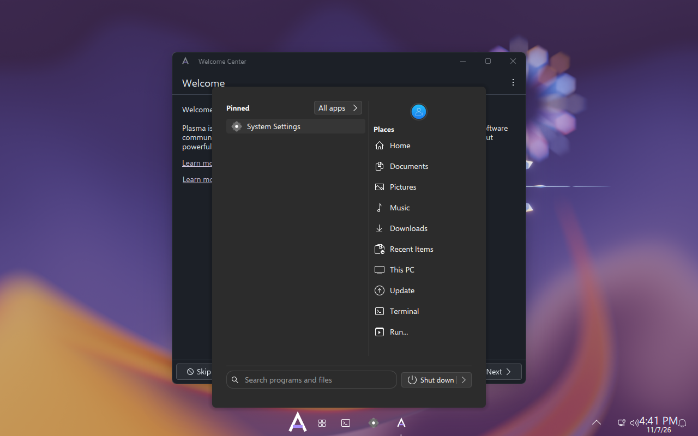
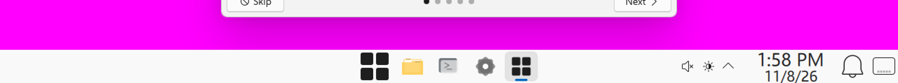
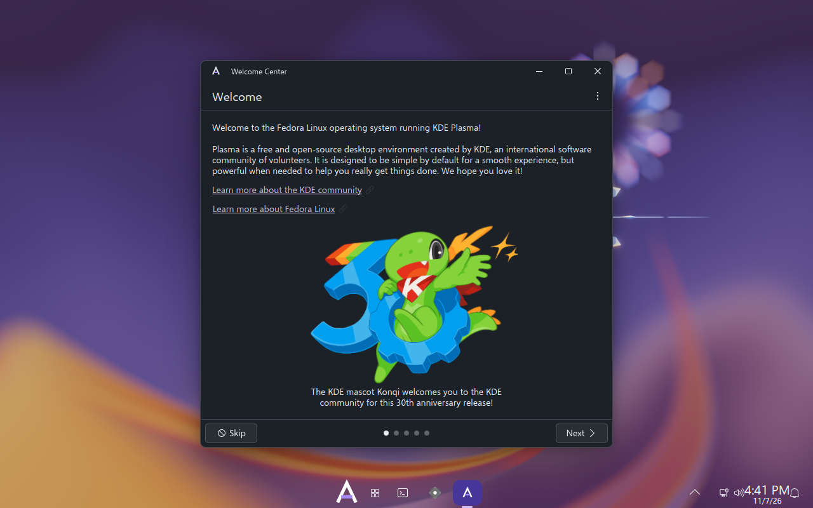
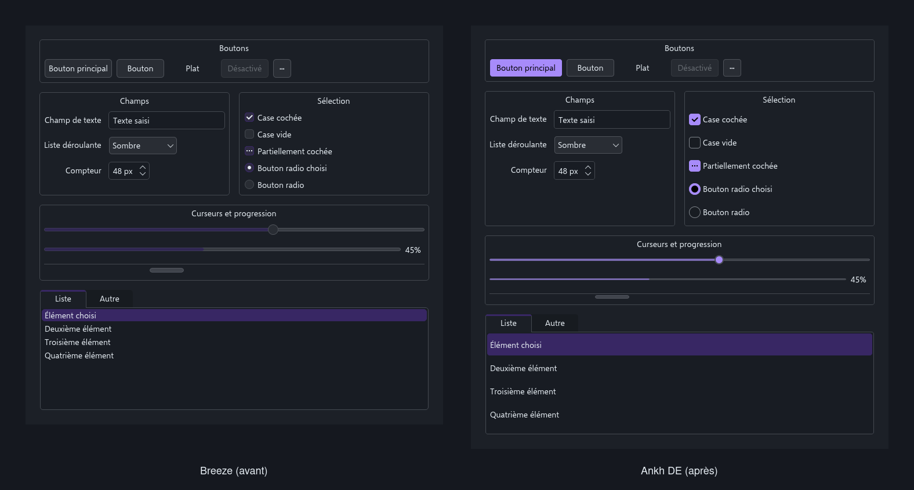
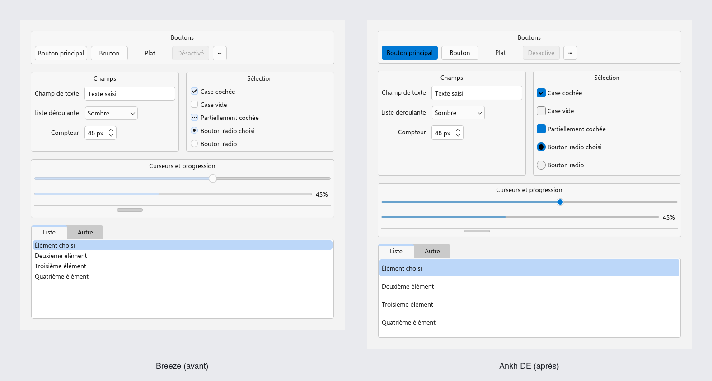

# Ankh DE

**La géométrie de Windows 11, les couleurs d'Ankh, sur KDE Plasma 6.**

*[English version](README.en.md)*

Ankh DE donne à Plasma les mesures, la typographie, les matières, les animations et la disposition
de Windows 11 — au pixel près, et **vérifiées par un programme** — sous l'identité graphite et
violet d'[Ankh](https://github.com/PatrickChoumi/Ankh). Il s'installe sur Fedora, Arch ou Ubuntu
sans modifier un seul fichier de la distribution, et se retire d'un geste.

> ### État : **pré-version** — la barre et le menu Démarrer sont à nous, et c'est prouvé.
>
> Ankh DE a été **installé par son propre installateur dans une VM neuve** (Fedora 44,
> Plasma 6.8.2) et la session ouverte **depuis l'écran de connexion**. Dans cette session :
> `ANKH_DE_SESSION=1`, style `Ankh`, couleurs `Ankh`, police `Selawik 10.5`, décoration
> `org.ankh.decoration`, icônes `Fluent-Ankh`, style Plasma `ankh`, Selawik trouvée par
> fontconfig, et **48 vérifications clé par clé** passées *dans la session* — le compte est
> imprimé par le test et repris dans le rapport, car il dépend des outils de l'invité.
>
> **Le menu Démarrer s'ouvre.** Trois preuves indépendantes, parce qu'une seule ne suffit pas :
>
> | Ce qu'on demande | Ce que le passage répond |
> |---|---|
> | Quelle disposition `plasmashell` a-t-il évaluée ? | `…/org.ankh.de.desktop/contents/layouts/org.kde.plasma.desktop-layout.js` — **la nôtre**, d'après son propre journal |
> | Qu'y a-t-il dans la barre ? | `org.ankh.demarrer`, `org.ankh.horloge`, `org.ankh.bureau` installés ; `icontasks` et la zone système restent ceux de Plasma, par repli assumé |
> | L'écran a-t-il changé à l'ouverture ? | **9,33 %** de l'écran, boîte de 662×694 à x=314 sur 1280 — donc **centrée**, et non collée à gauche comme Kickoff |
>
> Jusqu'au 2026-11-06 la barre visible était celle de **Breeze**, portant nos couleurs, nos
> icônes et notre thème Plasma : `kdeglobals [KDE] LookAndFeelPackage` n'était écrit nulle part
> ([DE-014](DECISIONS.md)). Ce déguisement a tenu le défaut caché plusieurs jours, et trois
> constats du harnais s'affichaient en « ÉCHEC » dans un passage vert. Les deux sont corrigés.
>
> **27 jetons sur 53 mesurés et conformes** — 12 contrôles, 6 fenêtres, et **les 9 de la barre**,
> relevés en VM sur `fbe7f47`, où **Construire, Banc et VM passent tous les trois sur le même
> SHA**. Détail et limites : [AVANCEMENT.md](AVANCEMENT.md),
> [ROADMAP.md](ROADMAP.md), [DECISIONS.md](DECISIONS.md).

## Le menu Démarrer, ouvert dans une vraie session



Capture prise par le moniteur de QEMU pendant le test `VM — session réelle`, après une demande
d'ouverture envoyée par le chemin que Plasma emploie lui-même pour la touche Windows
(`activateLauncherMenu`). Le nom du fichier est choisi d'après ce que l'image **montre** : s'il
ne s'était rien ouvert, il s'appellerait `vm-demarrer-rien-ne-sest-ouvert.png`.

## La barre des tâches



Les 120 px du bas de l'écran, à l'échelle 3. Le bouton Démarrer porte **le logo d'Ankh** —
aucun motif qui ressemble à un logo de Microsoft ([DE-013](DECISIONS.md)). L'application ouverte
est soulignée, et l'horloge est sur deux lignes, comme dans Windows 11.

## Le bureau



## À quoi ça ressemble

Le même contenu, les mêmes couleurs d'Ankh, la même police, la même échelle. **Seul le style
change** : à gauche Breeze, à droite Ankh DE.





Ces planches sont **produites par la CI à chaque changement**, pas prises à la main
(`bench/captures.sh`). Ce qu'on y voit, mesuré au même moment :

| Mesure | Windows 11 | Ankh DE | Breeze |
|---|---|---|---|
| Hauteur d'un bouton | 32 px | **32** | 34 |
| Hauteur d'un champ | 32 px | **32** | 31 |
| Case à cocher avec son texte | 32 px | **32** | 21 |
| Élément de liste | 40 px | **40** | 23 |
| Barre de défilement | 12 px | **12** | 21 |
| Barre de progression | 3 px | **3** | 6 |
| Poignée du curseur | 18 px | **18** | 20 |
| Police, corps | 14 px | **Selawik 14** | Selawik 14 |

> La décoration des fenêtres n'apparaît pas : la galerie tourne sans gestionnaire de fenêtres.
> La barre de titre de 32 px, les boutons de 46×32 et le Fermer `#C42B1C` se mesurent en session,
> avec KWin.

## Ce que c'est

| | |
|---|---|
| **Style des contrôles** | Un `QStyle` Qt 6 dérivé de Breeze : rayons de 4 et 8, boutons et champs de 32 px, barres de défilement fines, focus en double trait, aux mesures de WinUI |
| **Décoration des fenêtres** | Un greffon KDecoration3 : barre de titre de 32 px, titre à gauche, boutons de 46×32, Fermer rouge `#C42B1C` au survol, coins de 8 px, ombres de Windows 11 |
| **Thème global** | `org.ankh.de.desktop` : il porte tous les réglages, et la barre des tâches collée de 48 px en option |
| **Couleurs** | Les gris de Windows 11 rendus en graphite bleuté d'Ankh, rangés par couches, en sombre et en clair. L'accent suit le fond d'écran, comme l'accent « Automatique » de Windows 11 |
| **Police** | [Selawik](https://github.com/microsoft/Selawik), le sosie libre de Segoe UI publié par Microsoft sous OFL 1.1, compilée depuis ses sources |
| **Curseurs et icônes** | [Fluent](https://github.com/vinceliuice/Fluent-icon-theme) (GPL-3.0), recolorés au violet d'Ankh |
| **Applications GTK** | [Fluent-gtk-theme](https://github.com/vinceliuice/Fluent-gtk-theme) (GPL-3.0), au violet d'Ankh |
| **Banc de mesure** | 53 mesures, chacune avec sa cible Windows 11, sa tolérance et sa source. Un écart fait échouer la CI |

## Ce que ce n'est pas

- **Pas un environnement de bureau écrit de zéro.** Ankh DE ne remplace ni le compositeur, ni le
  gestionnaire de session, ni `plasmashell`. C'est une suite de thèmes et d'applets pour Plasma 6
  ([DE-001](DECISIONS.md#de-001--ankh-de-est-une-suite-de-thèmes-et-de-shell-posée-sur-kde-plasma-6-indépendante-de-toute-distribution)).
- **Pas un clone de Windows 11.** Les mesures sont celles de Windows, les couleurs sont celles
  d'Ankh ([DE-003](DECISIONS.md#de-003--cible--la-géométrie-de-windows-11-les-couleurs-dankh-reprend-d-052)).
- **Pas un produit Microsoft, et sans aucun lien avec Microsoft.** Aucun fichier de Windows n'est
  livré ni téléchargé : ni police, ni icône, ni son, ni curseur, ni fond d'écran. Seules les
  **mesures** sont reprises, de sources que Microsoft publie sous licence MIT
  ([DE-005](DECISIONS.md#de-005--rien-de-microsoft-dans-le-dépôt--seules-les-mesures-publiées-sous-licence-mit)).
- **Pas une distribution.** Ankh, le système, est personnel et n'est pas distribué. Ankh DE
  s'utilise sans Ankh.

## Installation

**Prérequis** : KDE Plasma **6.8.x**, session Wayland, Qt 6.6+, KDE Frameworks 6+.
Toutes les preuves de ce dépôt sont faites sur **6.8.2** (Fedora 44). Une autre version arrête
la construction, sauf `-DANKH_DE_PLASMA_NON_TESTE=ON`
([DE-008](DECISIONS.md), `src/decoration/VERSION-BREEZE`).

```bash
git clone https://github.com/PatrickChoumi/Ankh-DE
cd Ankh-DE
./installer.sh
```

L'installateur dit quels paquets manquent, pour Fedora, Arch et Ubuntu. Il :

1. compile le style et la décoration ;
2. fabrique la police, les curseurs et le thème GTK depuis leurs sources, à des commits figés ;
3. installe tout dans `/usr/local`, **y compris la session** ;
4. applique le thème global `org.ankh.de.desktop`.

Ensuite, **déconnectez-vous et choisissez « Ankh DE » à l'écran de connexion**, comme vous
choisiriez Plasma ou GNOME. C'est la session qui applique la police Selawik, le rendu des textes,
les durées d'animation de Windows 11, l'accent qui suit le fond d'écran et la disposition des
boutons de fenêtre : le thème global, seul, ne sait pas les porter
([DE-010](DECISIONS.md)).

La session ne remplace ni le compositeur, ni le gestionnaire de session, ni `plasmashell` : elle
lance celle de Plasma après avoir placé nos valeurs par défaut dans `XDG_CONFIG_DIRS`. Vos propres
réglages gardent donc la priorité sur les nôtres, et aucun fichier de votre distribution n'est
touché. **33 vérifications** relisent chaque réglage promis, à chaque PR.

**Vos barres ne sont pas touchées.** Pour avoir aussi la barre des tâches de Windows 11 (collée
en bas, 48 px, Démarrer et applications au centre), il faut le demander — et répondre « oui » à
l'avertissement, car cela **efface vos barres actuelles** :

```bash
./installer.sh --barre
```

Pour essayer sans droits root ni toucher au système (demande une reconnexion) :

```bash
./installer.sh --utilisateur
```

Pour tout défaire :

```bash
./desinstaller.sh
```

Détails : [docs/INSTALL.md](docs/INSTALL.md).

## Limites assumées

Honnêteté d'abord. « Trait pour trait » s'arrête là où Plasma s'arrête. Ces points **ne seront
pas corrigés** tant que KDE ne les ouvrira pas, et ils sont détaillés dans
[ANKH-DE-SPEC.md §4](ANKH-DE-SPEC.md#4-ce-qui-nest-pas-atteignable) :

- le **contenu** de l'OSD du volume et la **largeur** des notifications sont en dur dans Plasma ;
- **pas de menu de disposition** au survol du bouton « Agrandir » : rien de tel dans KWin. On a
  Windows+flèches et l'éditeur de tuiles (Windows+T) ;
- les applications **libadwaita** (Bottles, ProtonPlus…) gardent leur allure : elles ne reçoivent
  que la couleur d'accent, ramenée au violet d'Adwaita ;
- **Chrome, VS Code et les applications Electron** dessinent leur propre barre de titre ;
- les applications **GTK en Flatpak** ne voient pas le thème GTK du système ;
- **Démarrer** et les **paramètres rapides** (lots 5 et 6) passeront par des modules *privés* de
  Plasma : ils peuvent casser à chaque version. La CI le montrera avant que la mise à jour
  n'arrive chez vous ;
- Selawik n'a **pas de semi-gras** et son crénage est incomplet : un titre semi-gras s'affiche en
  gras.

## Documents

| Fichier | Contenu |
|---|---|
| [ANKH-DE-SPEC.md](ANKH-DE-SPEC.md) | La cible : la référence Windows 11 mesure par mesure, l'identité d'Ankh, les limites, la liste NON |
| [DECISIONS.md](DECISIONS.md) | Chaque choix, ses raisons, ses alternatives rejetées, sa vérification |
| [ROADMAP.md](ROADMAP.md) | Les onze lots, et le critère de fin de chacun |
| [AVANCEMENT.md](AVANCEMENT.md) | Ce qui est fait, et surtout ce qui n'est pas vérifié |
| [AUDIT.md](AUDIT.md) | **Tout ce qui manque**, établi en exécutant, et ce qu'une semaine peut donner |
| [docs/ARCHITECTURE.md](docs/ARCHITECTURE.md) | Comment c'est agencé, et le rapport avec Ankh |
| [docs/REBASE.md](docs/REBASE.md) | Reporter le code sur une nouvelle version de Plasma |
| [CONTRIBUTING.md](CONTRIBUTING.md) | Comment contribuer, et la règle du banc |

**Règle du projet** : ce dépôt est la source de vérité. Toute affirmation technique importante
s'appuie sur une documentation officielle, un test reproductible, ou une mesure du banc. Sinon,
elle est marquée `À VALIDER`.

## Licence

**GPL-3.0-or-later.** Ce n'est pas un choix : le style et la décoration dérivent de
[Breeze](https://invent.kde.org/plasma/breeze) (GPL-2.0-or-later), les curseurs et le thème GTK de
[Fluent](https://github.com/vinceliuice/Fluent-icon-theme) (GPL-3.0). La provenance et la licence
de chaque pièce sont dans [LICENSES/](LICENSES/).

Windows et Windows 11 sont des marques de Microsoft Corporation. Ce projet n'est ni affilié à
Microsoft, ni approuvé par Microsoft, et ne distribue aucun de ses fichiers.
